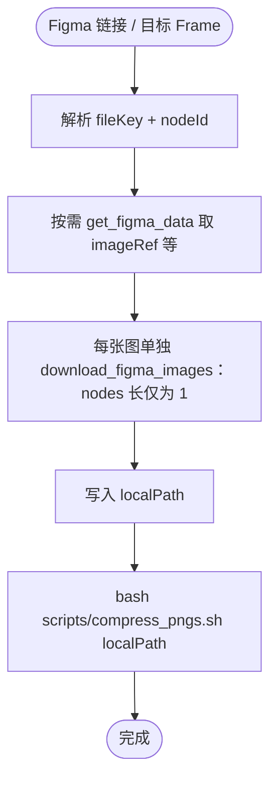

# Figma 资源流程 — 参考（Framelink + 压缩）

## Mermaid 流程图

## 能力对照

| 需求 | Framelink（本 Skill 主路径） | Figma 官方 MCP |
|------|------------------------------|----------------|
| 细切、imageRef、GIF、裁剪 | `download_figma_images`（**每次调用 1 个 node**） | 本 Skill 不替代 |
| 读结构 / 取 imageRef | `get_figma_data` | 可用 `get_design_context` 等辅助理解 |
| 下载后 PNG 体积优化 | 本 Skill：`compress_pngs.sh` | 无 |
| Code Connect / 变量 | 无 | 按需使用官方工具 |

## localPath

- **相对当前项目（Cursor 工作区根）**，如 `src/assets/figma`；与 `compress_pngs.sh` 传入目录一致。
- **禁止**写到用户主目录、绝对路径或其它工程根（与项目 Figma MCP Rule 一致）。

## 安全

- Framelink 访问令牌由 **Cursor MCP 配置**管理；勿把密钥写进 Skill 正文或提交进业务仓库。
- 下载目录若含敏感素材，按团队规范控制 Git 与访问权限。
