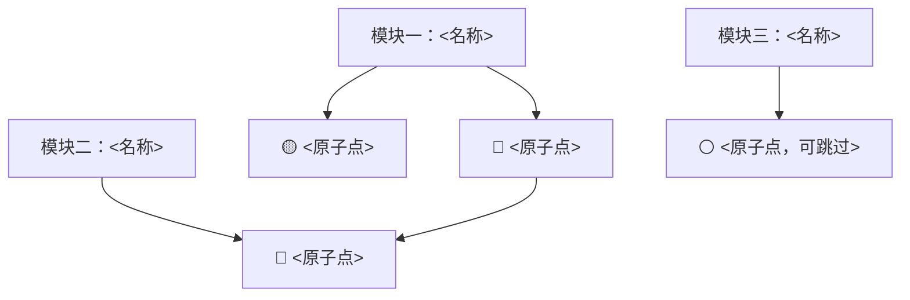

# 各阶段交付物模板

复制结构，填内容。**格式本身就是约束**：填不满格子 = 这一步没做完。

---

## 目录
1. 学习契约
2. 学习地图（Mermaid）
3. 最小闭环核心卡
4. 错题簿
5. 一页速查表
6. 资源评分表
7. 周路线表
8. 闭卷费曼评分表 + AI 听众提示词
9. 复习节点表
10. 前测记录
11. 交错题组

---

## 1. 学习契约

```markdown
# 学习契约：<主题>

- 目标：<一句话，含具体动作>
- 验收标准：<能做出 X / 能讲清 Y / 能达到布鲁姆「应用」层>
- 现有基础：<已掌握 A；缺 B>
- 时间预算：<6 周 × 每周 5 小时>
- 学习区定位：<当前能做 X，目标是能做 X+1>
- 明确不学：<本次排除 C、D>
```

坏的例子：「目标：学懂 Rust」。
好的例子：「目标：两周内用 Rust 写一个能并发下载 100 个 URL 的 CLI，并能讲清所有权为什么能保证无数据竞争」。

---

## 2. 学习地图（Mermaid）



规则：
- 节点名必须是一个能单独出题检验的**原子点**，不是章节名。
- 箭头 = 依赖（后者需要前者）。箭头方向从「先学」指向「后学」。
- 打标：`🔴核心`（进阶段 2）、`🟡支撑`（用到再查）、`⚪可跳过`（这次不学）。
- 3–6 个模块，每模块 3–6 个点。少于 3 个模块 → 拆得不够；超过 6 个 → 合得太细。

画完自检三问：有孤立节点吗？有依赖倒挂吗？每个 🔴 都能被一句话说清吗？

---

## 3. 最小闭环核心卡

```markdown
## 核心点 1：<名称>

**一句话定义**（不用术语）：
**为什么是杠杆**（去掉它会崩哪一环）：
**最小可运行例子**：
```
<代码 / 命令 / 算式 / 具体场景，5 行以内>
```
**新手最容易错的地方**：
- 误区：<具体错法>
- 纠正：<为什么错 + 正确做法>

**布鲁姆目标层级**：应用 / 分析（圈一个）
```

---

## 4. 错题簿

| # | 题目 | 用户答案 | 正确理解 | 判定 | 误因类型 | 补救动作 |
|---|---|---|---|---|---|---|
| 1 |  |  |  | ❌ | 概念混淆 | 做 A vs B 对比表 |
| 2 |  |  |  | ⚠️ | 边界不清 | 给 2 个反例 |

误因 → 动作对照：
- **概念缺失**：没学过 → 重讲（换例子，不重念定义）
- **概念混淆**：和邻近概念串了 → 两列对比表，只比差异维度
- **记忆模糊**：知道有这回事但说不准 → 进复习排期，闭卷回忆
- **边界不清**：知道是什么但不知道何时不适用 → 给反例 + 适用条件清单

---

## 5. 一页速查表

```markdown
# <主题> 速查表

## 核心定义
- <术语>：<一句话>
（3–5 条，多了就是没提炼）

## 决策规则
| 情况 | 用哪个 | 为什么 |
|---|---|---|

## 关键公式 / 命令
```
<能直接复制跑的片段>
```

## 最小可跑示例
```
<10 行以内，能复制即用>
```

## 五大坑
1. <坑> → <怎么避开>

## 检索线索
- 忘了 X 去查：<哪里>，搜关键词 `<词>`
```

要打印/贴墙时改用 `assets/cheatsheet-template.html`（A4 单页，浅色，直接 Cmd+P）。

---

## 6. 资源评分表

| 坑位 | 资源 | 权威性 | 相关度 | 时效性 | 上手成本 | 总分 | 结论 |
|---|---|---|---|---|---|---|---|
| 1 系统教材 |  | 5 | 5 | 4 | 3 | 17 | 入选 |
| 2 快速入门 |  | 4 | 5 | 5 | 5 | 19 | 入选 |
| 3 实战案例 |  | 3 | 4 | 3 | 2 | 12 | 淘汰：太旧 |

评分口径（1–5）：权威性=作者/机构在该领域的可信度；相关度=覆盖目标的比例；时效性=内容是否过期；上手成本=5 表示最容易上手。
**≥16 入选，一个坑位只留一个。** 淘汰的写一句原因，避免以后又捡回来。

---

## 7. 周路线表

| 周 | 主题模块 | 学（核心点+承重墙） | 练（最小产出） | 讲（闭卷） | 测（闭卷） |
|---|---|---|---|---|---|
| W1 | 模块一 | <2 个核心点> | <一个能跑的东西> | 讲给 AI，3 分钟 | 5 题 |
| W2 | 模块二 |  |  |  |  |

规则：每周必须有「练」的产出物（代码/文档/作品），没有产出的周不算数。
整体周期按西蒙学习法固定，中途不加新主题。

---

## 8. 闭卷费曼评分表 + AI 听众提示词

前提：用户**闭卷**讲（收走速查表、地图、笔记），否则不算检索。

| 维度 | 分（1–5） | 证据（原话） | 缺口 |
|---|---|---|---|
| 准确 |  | 「……」 | <哪句错了> |
| 完整 |  |  | <漏了哪个前提> |
| 通俗 |  |  | <术语未解释：X、Y> |
| 有例子 |  |  | <结论无实例支撑> |

<3 分的维度 → 让他重讲那一段，我只提问、不给答案。收尾产出「讲解稿 v2」，并附一道迁移题的结果。

### AI 听众提示词（照抄给用户，或我自己遵守）

```
你不回答问题，你只挑毛病。
1. 我先讲，你别打断，讲完再说。
2. 讲完你只做三件事：
   - 指出我跳过的一步（"你从 A 直接到 C，B 呢？"）
   - 指出我没定义就用的词
   - 要求我给一个具体例子
3. 你可以故意说错 2–3 处，引我纠正。（约束式指令比"你扮小白"有效得多）
4. 我如果让你解释，你回答："你是老师，你来讲，我只负责挑毛病。"
5. 不许替我补全，不许总结我的内容。
```

为什么这样写：模型默认会滑回专家口吻、会秒认错、会顺手把答案说了。光让它「扮演新手」不可靠，必须给硬约束（必须答错 N 处）+ 反向防御（拒答）+ 禁止代劳。

---

## 9. 复习节点表

| 节点 | 日期 | 闭卷问题（3 个） | 结果 |
|---|---|---|---|
| D+1 |  | 1. 2. 3. |  |
| D+2 |  |  |  |
| D+4 |  |  |  |
| D+7 |  |  |  |
| D+15 |  |  |  |
| D+30 |  |  |  |

问题要求：能闭卷口头回答、答案唯一、不用查资料。❌ 项下一轮占一半题量。第一轮必须含阶段 0.5 的前测原题。

---

## 10. 前测记录

| # | 题目（覆盖哪个 🔴 点） | 初始答案 | 正确答案 | D2 重考结果 |
|---|---|---|---|---|
| 1 |  |  |  |  |
| 2 |  |  |  |  |
| 3 |  |  |  |  |
| 4 |  |  |  |  |
| 5 |  |  |  |  |

出题要求：
- 全部落在后面地图的 🔴 核心点上，一题一个点。
- 难度要让他**几乎必错**。答对了说明题太浅，换。
- 只问「会怎样 / 为什么 / 用哪个」，不问「是什么」。
- 答完立刻给答案 + 一句为什么，**不展开讲**（展开讲就变成提前上课，前测的效应会被吃掉）。

用法：D2 阶段 3 末尾原题重考，两次对照能直接看出「学了一遍到底有没有变」；D3 闭卷费曼时可再引一次作对照。

---

## 11. 交错题组（阶段 3 后 1/3 用）

先列出所有**容易混**的核心点，两两成对，再按「不出现连续同类型」排列。

| 序 | 题目 | 先答：这题考哪个点？为什么？ | 再解 | 分类对否 |
|---|---|---|---|---|
| 1 |  |  |  | ✅/❌ |
| 2 |  |  |  |  |
| 3 |  |  |  |  |

规则：
- 只混**相似易混**的（同名不同义、同场景不同法、边界相邻），不混不相关主题。
- 「分类错」比「解法错」严重：归类到错题簿的「概念混淆」，用两列对比表补救。
- 交错题不给提示、不说「这题和上一题不一样」。
- 交错组通常比同量分块题**更慢**，别压缩思考时间。
